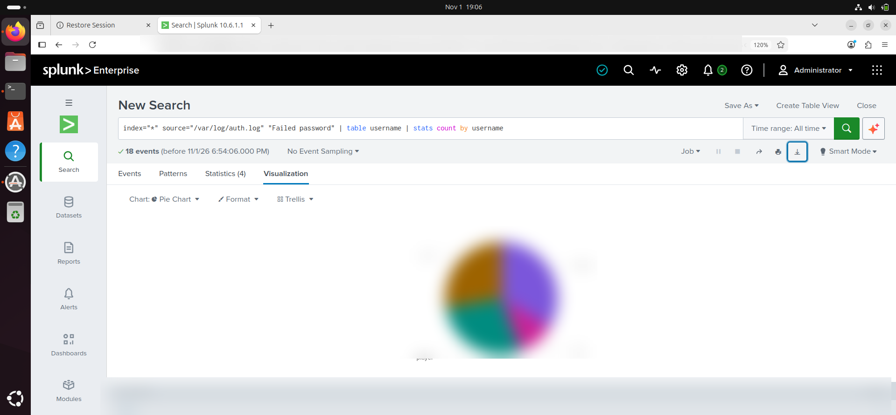
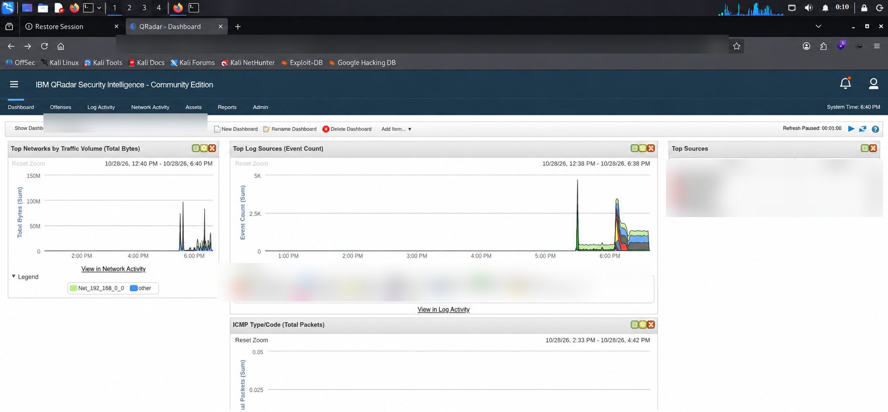
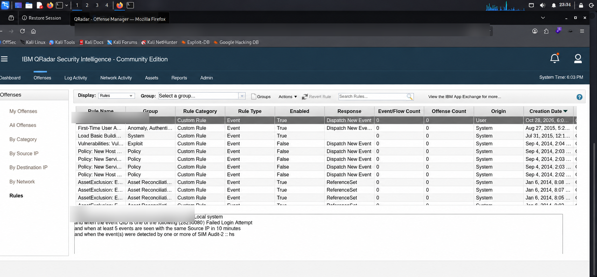
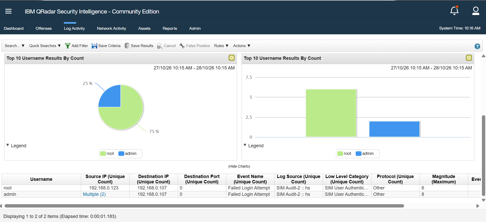
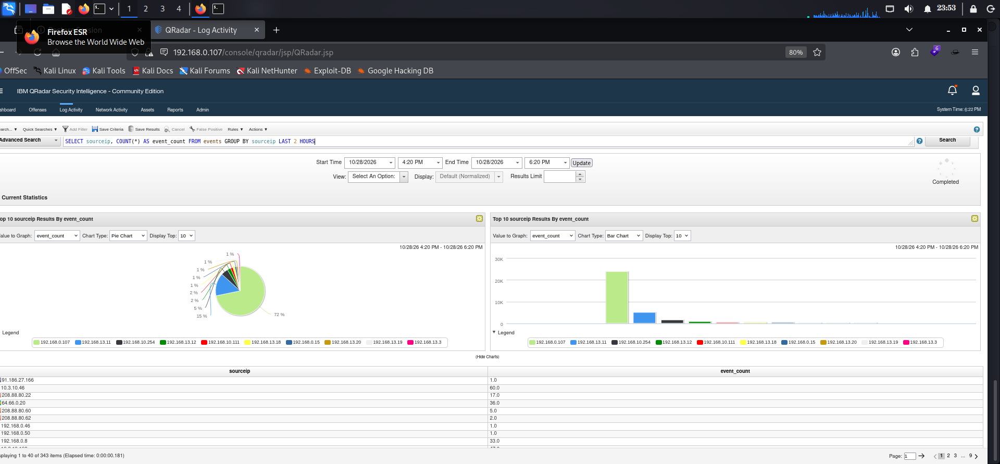
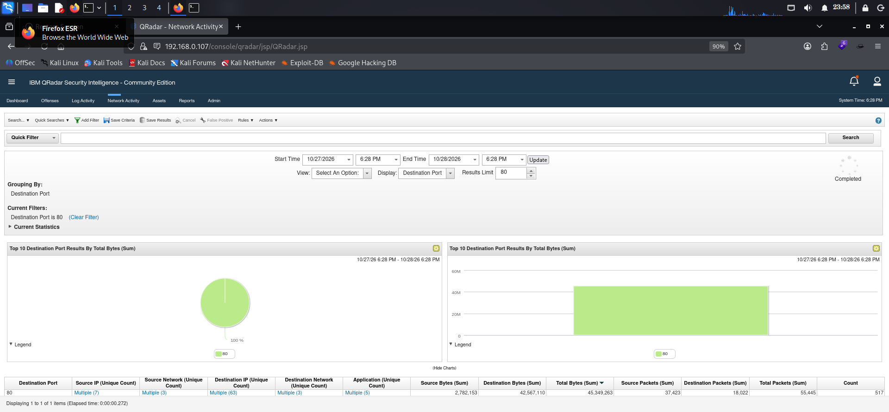
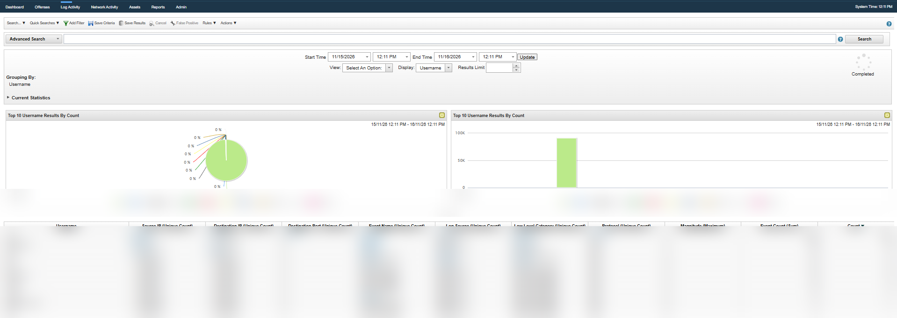
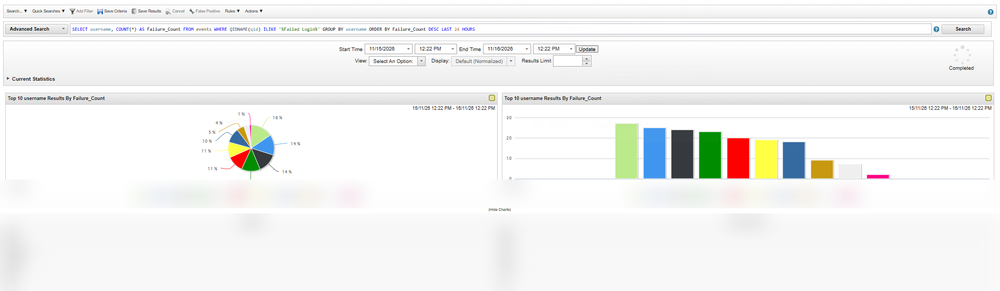

# Failed Login Detection and Investigation — Splunk & IBM QRadar

A hands-on SOC/SIEM lab documenting failed-authentication monitoring, event analysis, correlation-rule configuration, and network-activity review using **Splunk Enterprise** and **IBM QRadar Community Edition**.

**Suggested repository name:** `soc-failed-login-detection-splunk-qradar`

## Project summary

This project demonstrates a basic security-monitoring workflow across two SIEM platforms. It uses Linux authentication events in Splunk and QRadar to review failed-login activity, summarize event patterns, configure a threshold-based correlation rule, and inspect related network activity.

The screenshots are sanitized for portfolio sharing. IP addresses, usernames, host identifiers, and other identifying values are obscured where they appear.

## Objectives

- Search Linux authentication logs for failed-password events in Splunk.
- Aggregate authentication failures by username.
- Review QRadar dashboards, log sources, and event activity.
- Examine event summaries by username and source.
- Configure a QRadar rule for repeated failed-login events.
- Use AQL to summarize source activity and failed-login frequency.
- Review network activity filtered to destination port 80.
- Document findings without exposing identifying lab data.

## Tools and technologies

| Tool / technology | Purpose |
|---|---|
| Splunk Enterprise | Search and visualize Linux authentication events |
| IBM QRadar Community Edition | SIEM dashboards, log activity, correlation rules, and network activity |
| SPL | Splunk Search Processing Language |
| AQL | QRadar Ariel Query Language |
| Linux `/var/log/auth.log` | Authentication-event source shown in the Splunk search |

## Investigation Evidence

The following screenshots document the practical work performed in Splunk Enterprise and IBM QRadar Community Edition. Image filenames match the files in the screenshots/ directory.

### 1. Splunk — failed-password search

```spl
index="*" source="/var/log/auth.log" "Failed password"
| table username
| stats count by username
```

The captured search reports 18 matching events for the selected time range and groups the results by username.



### 2. QRadar — security dashboard

The dashboard displays monitoring panels for network traffic volume, log-source event counts, top sources, and ICMP activity.



### 3. QRadar — custom failed-login rule

The rule configuration shown specifies a `Failed Login Attempt` event (QID `28250080`), at least five events from the same source IP within ten minutes. The screenshot demonstrates configuration; it does not establish that the rule generated an offense.



### 4. QRadar — log activity and username summary

The Log Activity view presents username-based event summaries, including source/destination context, event names, log sources, and event magnitude. Identifying values are obscured.



### 5. QRadar — AQL source-event analysis

The AQL query shown groups event counts by source IP over the last two hours:

```sql
SELECT sourceip, COUNT(*) AS event_count
FROM events
GROUP BY sourceip
LAST 2 HOURS
```

This provides a high-level view of event volume by source. Source identifiers are obscured.



### 6. QRadar — network activity

The Network Activity view is filtered to destination port `80`. The results include traffic and packet fields such as source bytes, destination bytes, total bytes, source packets, and destination packets.



### 7. QRadar — username-based event overview

This view groups event results by username and includes source/destination context, event names, log-source details, and event-count fields. Identifying values are obscured.



### 8. QRadar — failed-login frequency analysis

The AQL query shown ranks usernames by failed-login event count over the last 24 hours:

```sql
SELECT username, COUNT(*) AS Failure_Count
FROM events
WHERE QIDNAME(qid) ILIKE '%Failed Login%'
GROUP BY username
ORDER BY Failure_Count DESC
LAST 24 HOURS
```

The screenshot shows the resulting distribution and ranking. Usernames and related identifying values are obscured.



## Investigation workflow

1. Review SIEM dashboards and select a relevant time range.
2. Search for failed-authentication events.
3. Aggregate events by username and source.
4. Review event details and available log-source context.
5. Configure a correlation rule for repeated failures.
6. Review related network activity.
7. Record observations, limitations, and recommended follow-up.

## Key learning outcomes

- Searching and aggregating Linux authentication events with SPL.
- Reviewing SIEM dashboards and log activity in QRadar.
- Writing AQL queries to summarize event patterns.
- Understanding threshold-based correlation rules.
- Reviewing source-based event patterns and network-activity fields.
- Preparing sanitized evidence for technical documentation and a portfolio.

## Findings and limitations

- The screenshots represent lab observations from the displayed time ranges, not a confirmed production incident.
- Repeated failed logins are an investigation indicator; they do not independently prove a successful compromise or a brute-force attack.
- The rule screenshot demonstrates configuration only; it does not prove that an offense was generated.
- Destination port 80 traffic is not inherently malicious and requires additional context.
- Identifying usernames, IP addresses, and selected host details are obscured in the distributed screenshots.


```

## Disclaimer

This project is for educational purposes and authorized lab practice only. Do not access or test systems without permission.

---

**Learn · Detect · Investigate · Document**
