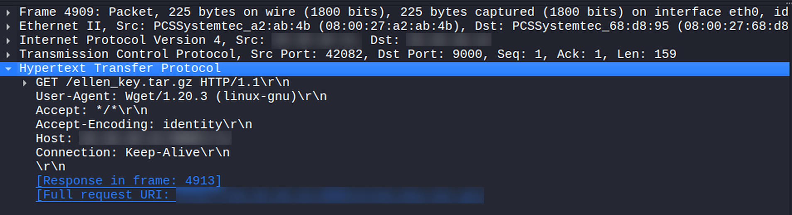
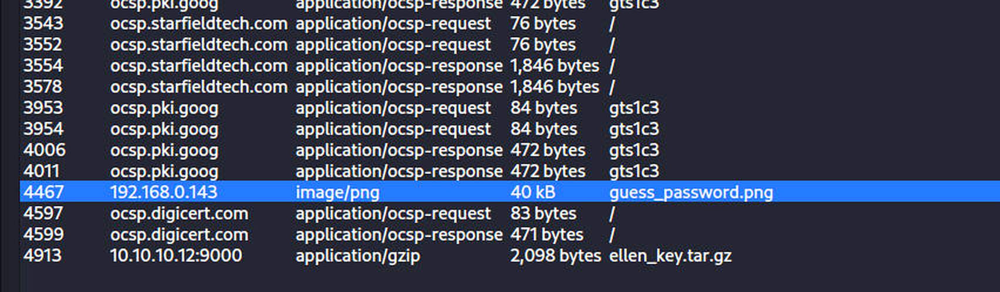
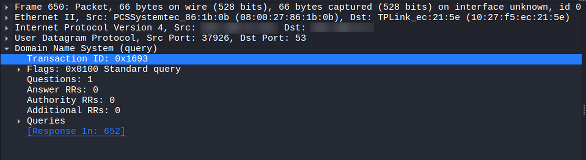
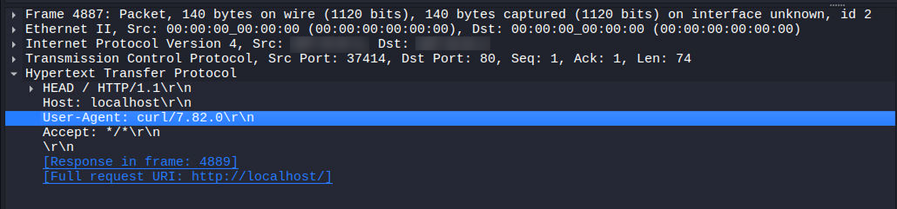
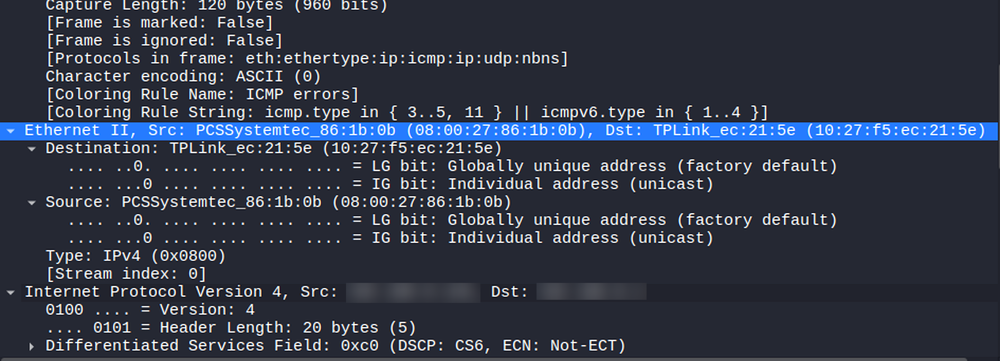
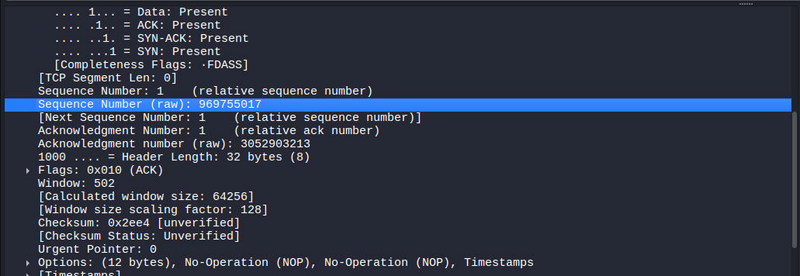
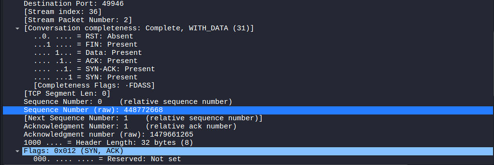

# Wireshark Network Traffic Analysis

A practical packet-analysis using **Wireshark** and the supplied `scanme.pcapng` capture. The exercises inspect HTTP, DNS, ICMP, and TCP traffic and document the investigation workflow with screenshots.

> **Lab note:** Perform packet analysis only on captures and systems you are authorized to inspect. The original capture file is not included.

## Lab objectives

1. Identify the User-Agent in an HTTP GET request to the target host.
2. Inspect exported HTTP objects and identify an image file and its extension.
3. Find the Transaction ID for a DNS A-record query for `hacker`.
4. Identify the User-Agent in an HTTP HEAD request using loopback addresses.
5. Identify the source IP and MAC address for an ICMP Echo Request.
6. Inspect the final ACK in a TCP three-way handshake and read its raw sequence number.
7. Inspect the SYN, ACK packet in a TCP three-way handshake and read its raw sequence number.

## Analysis workflow

### 1. HTTP GET User-Agent

Apply the display filter:

```wireshark
http.request.method == GET
```

Review the matching packets, locate the request from the source specified in the assignment, and expand **Hypertext Transfer Protocol** to inspect the `User-Agent` field.



### 2. Exported HTTP image object

In Wireshark, open **File → Export Objects → HTTP**. Review the transferred objects, identify the image entry, and inspect its filename, content type, packet number, and preview.



### 3. DNS A-record query

Apply the display filter:

```wireshark
dns
```

Locate the **Standard query** for the A record named `hacker`. Expand **Domain Name System (query)** and inspect the **Transaction ID** field.



### 4. HTTP HEAD User-Agent

Apply the display filter:

```wireshark
http.request.method == HEAD
```

Select the request whose source and destination are loopback addresses. Expand **Hypertext Transfer Protocol** and inspect `User-Agent`.



### 5. ICMP source IP and MAC address

Apply the display filter:

```wireshark
icmp
```

Select the first ICMP Echo Request. Read the source MAC address under **Ethernet II** and the source IP address under **Internet Protocol Version 4**.



### 6. TCP three-way handshake: final ACK

Use the address filter from the assignment:

```wireshark
tcp && ip.addr == 192.168.0.143 && ip.addr == 34.98.75.36
```

Locate the SYN, SYN/ACK, and ACK packets. Select the third packet (ACK), expand **Transmission Control Protocol**, and inspect **Sequence Number (raw)**.



### 7. TCP three-way handshake: SYN/ACK

The assignment first searches for traffic containing `hackerschool.in`, then filters the handshake using the resolved peer address. Apply the display filter:

```wireshark
ip.addr == 192.168.0.143 && ip.addr == 104.21.65.93
```

Locate the SYN, SYN/ACK, and ACK packets. Select the second packet (SYN/ACK), expand **Transmission Control Protocol**, and inspect **Sequence Number (raw)**.




## Skills demonstrated

- Wireshark display filters
- HTTP request and User-Agent inspection
- HTTP object export and file identification
- DNS query inspection
- ICMP and Ethernet header analysis
- TCP three-way handshake analysis
- TCP raw sequence-number inspection

